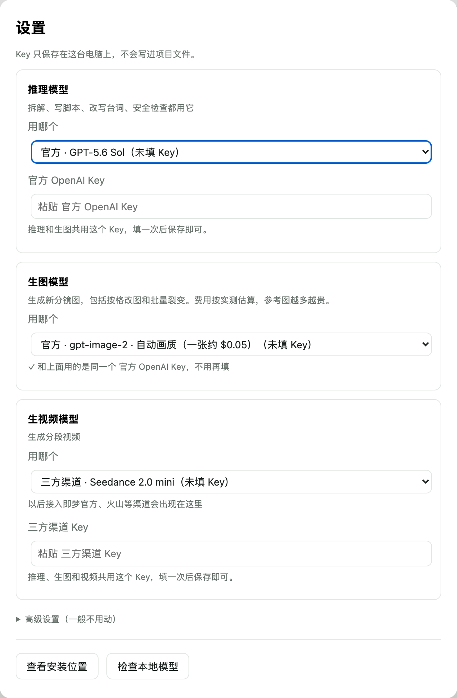
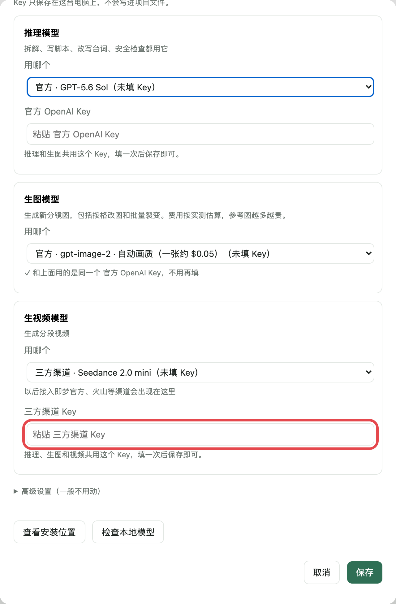
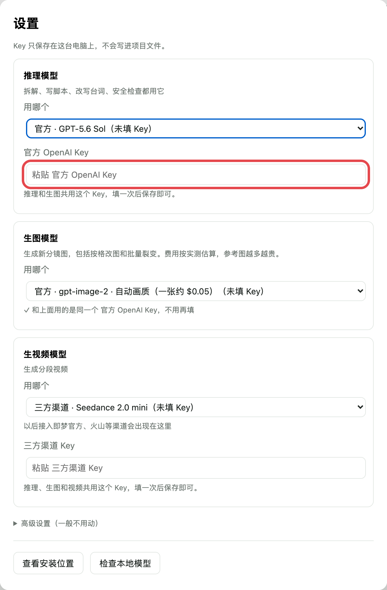
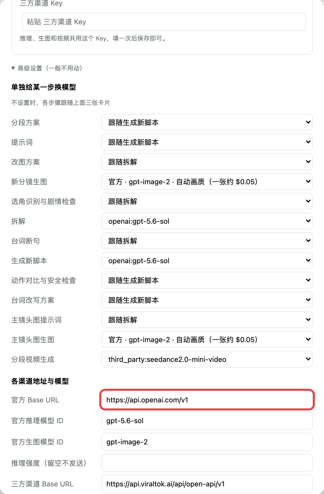

# 爆款复刻工作台

把一条带货爆款视频，换成你自己的模特和商品，复刻出一条新视频。整个过程在一个本地网页里完成：哪一步都看得见，哪一格不对就改哪一格，调用付费接口之前都会先让你确认。

```
01 上传对标视频 → 02 拆解对标视频 → 03 选角和商品 → 04 对照和修改 → 05 成片
```

- **拆解在本地跑**：识别台词（faster-whisper / 可选 WhisperX）、切镜头、抽关键帧都在你自己电脑上完成；只有“理解剧情”这一步调用推理模型。
- **先出图，再出视频**：原片分镜和新分镜一格对一格，点一格写一句话只改这一格，拖框可以一次改几格。分镜满意了再生成视频。
- **批量裂变**：把做好的一条当母版，人物选几张、商品选几张，自动组合出一批（一次最多 20 条），有批量看板看每条的进度。
- **数据都在本地**：原片、素材、生成结果都存在本文件夹的 `projects/`；Key 只存在本文件夹的 `console.env`。

## 三步用起来

**1. 下载**：点本页右上角绿色的 **Code → Download ZIP**，解压到任意文件夹；会用 git 的话也可以：

```bash
git clone https://github.com/cs6h2wsz4r-ship-it/viral-replica-workbench.git
```

**2. 双击启动**：macOS 双击 `start.command`，Windows 双击 `start.bat`。

第一次启动会自动安装（约 10 分钟，只装一次）：Python 3.12、依赖、FFmpeg，以及拆解用的本地模型 Whisper medium（约 1.4GB）。全部装进本文件夹的 `runtime/`，不写到系统目录；连不上 Hugging Face 时会自动换国内镜像。装好后浏览器会自动打开 http://127.0.0.1:8765 ，以后再双击就是秒开。

**3. 填 Key**：网页右上角“设置”里填你自己的 Key（见下一节），就能开始复刻。

> macOS 第一次双击如果提示“无法打开，来自身份不明的开发者”：右键 `start.command` → 打开 → 再点“打开”。
> 想手动安装也可以：macOS 终端运行 `./install.sh`，Windows 双击 `install.bat`。国内网络加 `--mirror`（Windows 用 `-Mirror`）；要更准的逐词对齐加 `--whisperx`（Windows 用 `-WhisperX`，另需约 2GB）。

**卸载**：删除整个文件夹即可。

## 配置 Key（新手照着做）

工作台本身免费，但拆解剧情、生图、生视频要调用 AI 模型，需要你自己的 Key（相当于付费账号的钥匙）。Key 只保存在本文件夹的 `console.env` 里，不会上传，也不会进 git。

### 先弄清楚：要填哪个 Key？

| 你的情况 | 要填的 Key | 能做什么 |
| --- | --- | --- |
| **最省事（推荐新手）** | 只填 **三方渠道 Key**（ViralTok） | 拆解、生图、生视频全部能用 |
| 有 OpenAI 账号 | 再填 **官方 OpenAI Key** | 拆解和生图改走 OpenAI 官方，生视频仍走三方渠道 |
| 用中转 / 其他模型 | OpenAI 兼容中转、DeepSeek、豆包、自定义接口的 Key | 拆解（推理）换成这些；生图可用 OpenAI 兼容中转 |

> 生视频目前只支持三方渠道（ViralTok），所以**三方渠道 Key 是必填的**；其余都是可选。

### 第 1 步：拿到三方渠道 Key（ViralTok）

1. 打开注册链接注册并登录：https://api.viraltok.ai/register?invite=rZKGj5bp
2. 登录后进入 **开放平台控制台**，点 **API 密钥** 标签页。
3. 点右边的 **＋ 创建 API 密钥**，创建好后点密钥旁边的复制按钮，复制下来（以 `sk_` 开头）。
4. 同一个页面上方的 **可用余额** 要有余额才能生成，没有的话点 **立即充值**。生成时按次扣费。

> 页面上的 “API 基础地址” `https://api.viraltok.ai/api/open-api/v1` 工作台已经默认填好了，不用改。

### 第 2 步：（可选）拿到官方 OpenAI Key

1. 打开 https://platform.openai.com/api-keys ，登录后点 **Create new secret key**，复制下来（只显示一次）。
2. 在 Billing 里充值，否则调用会失败。

### 第 3 步：填进工作台

1. 双击启动后，点网页右上角 **设置**。

   

2. 在 **生视频模型** 卡片下面的 **三方渠道 Key** 里粘贴你的 ViralTok Key（红框处）。推理、生图、视频都会用它。

   

3. （可选）有 OpenAI Key 的话，粘贴到 **推理模型** 卡片下的 **官方 OpenAI Key**。生图默认和推理共用这个 Key，不用再填。

   

4. 点右下角 **保存**。每张卡片下的 **测试连接** 可以检查 Key 能不能用（会产生极少量费用）。

### 用中转或其他模型（可选）

- **OpenAI 兼容中转**：打开设置最下面的 **高级设置（一般不用动）**，把 **官方 Base URL** 从 `https://api.openai.com/v1` 改成你中转的地址（通常以 `/v1` 结尾），再把中转给你的 Key 填到“官方 OpenAI Key”。推理和生图都会走这个地址。

  

- **DeepSeek / 豆包 / 自定义**：在 **推理模型** 的“用哪个”里选对应渠道，下面会出现它自己的 Key 输入框；地址和模型 ID 在高级设置里改。

### 填好以后

- 卡片里显示“未填 Key”的选项不能用；填好保存后，这几个字会消失。
- 没填官方 OpenAI Key 时，工作台会自动改用三方渠道，不用手动切换。
- 换 Key：直接在原来的框里粘贴新的再保存；框里留空保存不会清掉旧 Key。
- 每次真正花钱（生图、生视频、检查视频）之前，工作台都会先弹出确认，你点了才会调用。

## 常见问题

- **第一次启动很慢 / 卡在下载**：第一次要下载约 2GB（Python、依赖、FFmpeg、Whisper 模型），网络慢时请耐心等。中途失败了，再双击一次启动文件即可，已下载的不会重复下载。国内网络慢可以手动运行 `./install.sh --mirror`（Windows：`install.bat -Mirror`）。
- **网页打不开**：确认启动窗口没有关掉（关掉窗口工作台就停了），然后在浏览器打开 http://127.0.0.1:8765 。
- **提示端口 8765 被占用**：关掉占用的程序，或者重启电脑后再双击启动。
- **生成时报“还没填三方渠道 Key”**：回到设置，按上面第 3 步填好并保存。
- **数据在哪**：所有项目在本文件夹的 `projects/`，素材库在 `library/`；换电脑时把整个文件夹拷过去即可。

## 致谢和许可

拆解流程（媒体探测、逐词转录、镜头切点、带台词的帧网格）参考了 [Hypit](https://github.com/hypit-ai/hypit) 的做法，`console/kits.py` 中的 Seedance / GPT Image 提示词模板文字取自 Hypit。按 Hypit 许可证的要求，本项目以同样的许可证发布，详见 `LICENSE` 和 `THIRD_PARTY_NOTICES.md`：可以自用、改、再发布，但不能拿去收费分发或做成多租户服务。
